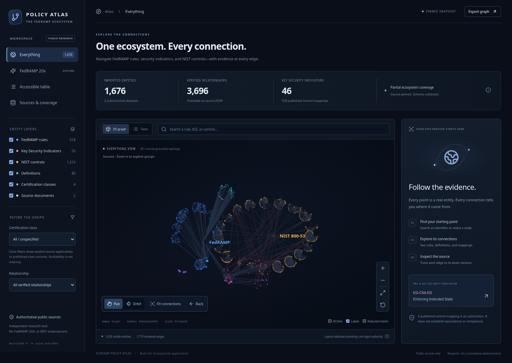
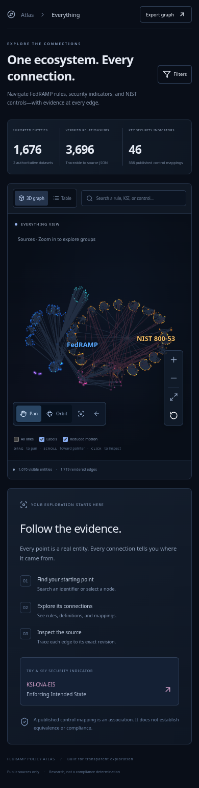

# Map label, color, focus and reset corrections

This slice addresses the five reported interaction issues without changing movement controls, imported data, or relationship semantics.

## Changes

- The canvas border was focus feedback. Pointer input no longer displays a canvas outline. Keyboard Tab/navigation still displays a blue focus indicator, and its modality listeners are removed when the map unmounts.
- Hover no longer changes placement priority or triggers label repacking. Stationary camera layouts are cached, valid label anchors are retained, and zoom eligibility is independent of whether a collision happened to suppress a label. Hover changes styling only.
- The initial unselected view shows source, family, ruleset, theme, and class labels. Individual rule/KSI/control/definition/subset labels require a closer zoom tier. Entering and leaving that tier uses different thresholds. Explicit selection remains an exception so its immediate relationships can be read.
- FedRAMP rules/source hubs are blue (`#59a9ff`); NIST families/controls/enhancements/source hubs are amber (`#f3bb62`). The legend, search results, inspector, table, labels and points share the same color resolver. KSI, definition and certification-class colors retain their existing categories.
- Added a distinct **Reset view** button that restores the starting front-facing camera, center, zoom and Pan mode. It retains selection and data filters. **Fit all entities** is separately named and retains the current orbital angle while fitting visible entities; it is not a fullscreen action. Reset settles any remaining control damping and clears intermediate label anchors when its animation completes. It also works with reduced motion.

## Validation

Forty automated tests pass: 13 navigation/model checks plus the 12 source-fidelity tests and 15 update lifecycle tests. Lint, typecheck and production build pass.

Fifty-four browser checks pass against the production build at the GitHub Pages project prefix: 18 existing graph checks, seven update-status checks, 15 navigation checks, and 14 new polish checks. The polish checks reproduce repeated pointer motion over both group and individual labels and verify that all visible label IDs/positions remain unchanged. They also check pointer/keyboard focus distinction, initial group-only labels, zoom thresholds, publisher colors, Fit all versus Reset, reduced-motion reset and mobile layout. [Results](map-polish-browser-results.json).

The browser checks use local Chromium software WebGL and a simulated mobile viewport. They are not a claim of full accessibility conformance, physical-device touch validation, or a live public-site browser test.

## Screenshots

## Source-first label hierarchy — 2026-10-30

The unselected starting view now labels only FedRAMP and NIST 800-53. Zooming to less than 84% of the starting camera distance switches to real family, class, ruleset and KSI-theme labels. At less than 46%, individual identifiers replace the group labels. Zooming out uses separate 56% and 94% thresholds to avoid toggling near a boundary. These are presentation levels, not new graph entities or inferred relationships.

Labels are single-line text without card backgrounds or borders. Sources use 13px text; groups and details use 11px text with a subtle dark shadow for contrast. Full titles remain available through tooltips, accessible names and the inspector. The current level and a short zoom hint appear above the map. The desktop caps are two sources, ten groups and eighteen details; narrow maps use five groups and eight details. Selection keeps its direct neighbors available within a separate limit (24 desktop, 12 narrow), with all relationships still available in the inspector.

The layout remains collision-managed and stable under hover. Reset restores the source level for an unselected map. The graph, source revisions and provenance are unchanged.

Screenshots: `screenshots/map-polish-overview.png`, `screenshots/map-polish-groups.png`, `screenshots/map-polish-details.png`, `screenshots/map-polish-mobile.png`. Browser validation uses the production build under the GitHub Pages project path. These checks do not substitute for physical-device or user usability testing.
