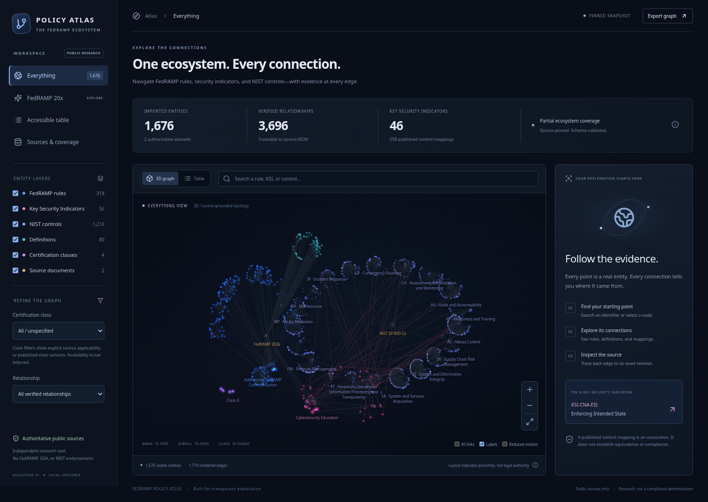
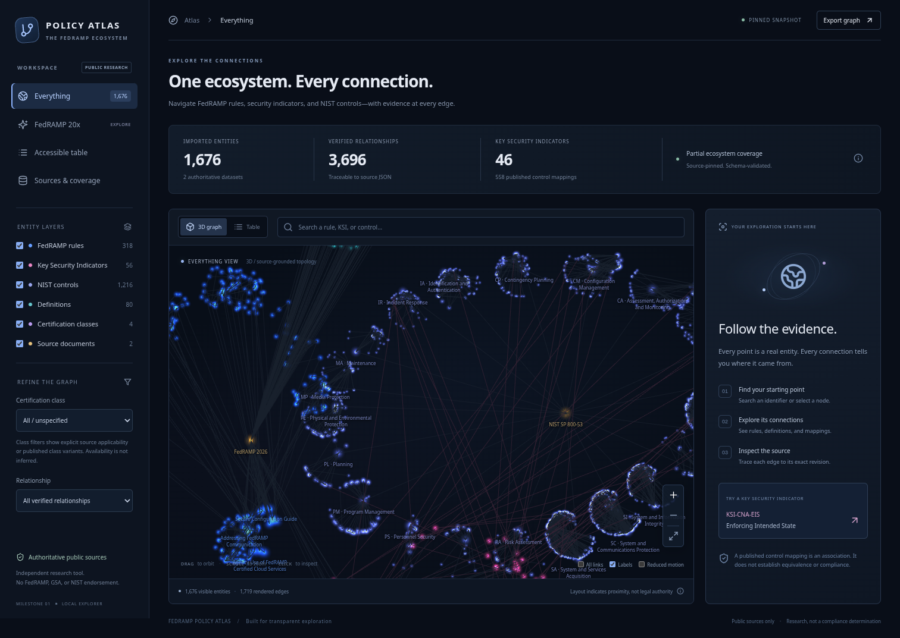
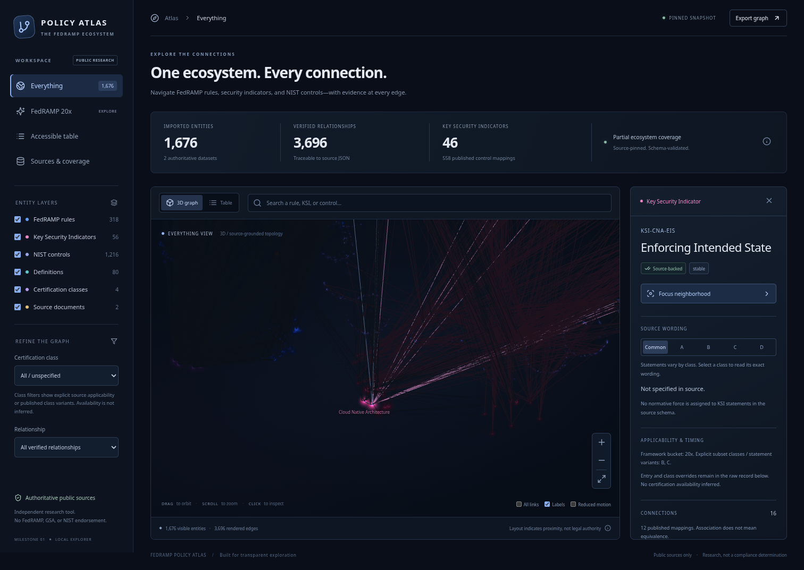
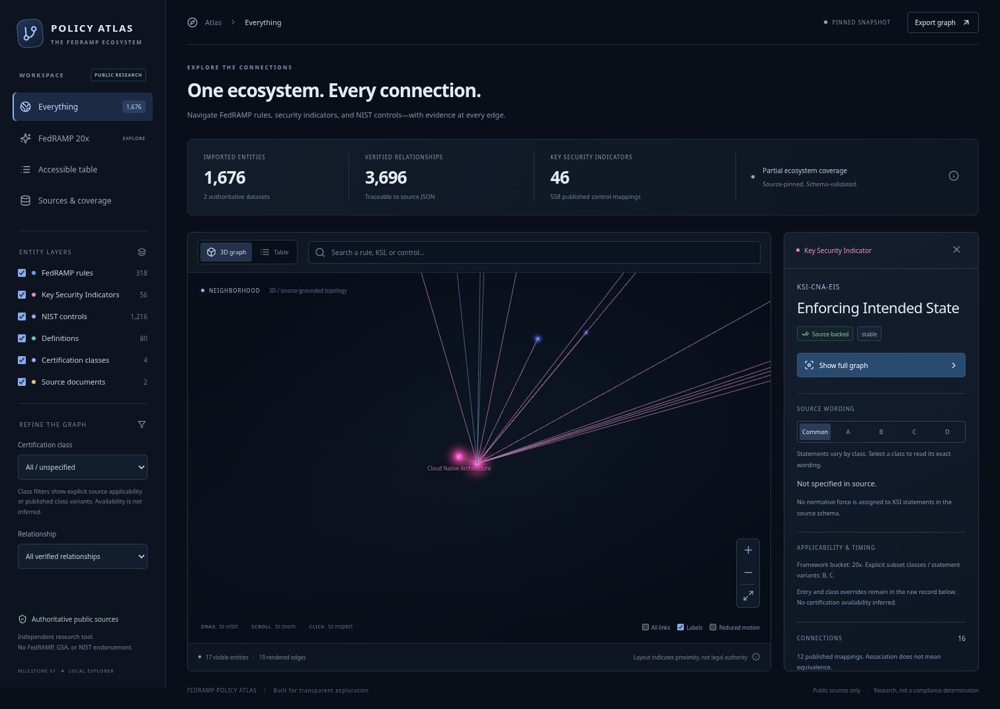

# Navigation research and proposed next slice

This is a research recommendation, not an implemented redesign. Preserve the approved dark, clustered 3D visual direction. The requested experience is a galaxy map that is easy to move through and reveals useful labels and relationships at the right scale.

## Scope and evidence

Reviewed the current locally served production build at `/FedRAMP-Policy-Atlas/`, using fresh desktop screenshots and DOM observations, and checked the relevant renderer/layout code. This was not a new live-site audit: requests to the public site remain constrained by the execution environment's network policy. No application code, deployment, or GitHub setting was changed for this research.

The browser skill/shared Product Design preflight resources were unavailable through the skill catalog. Screenshots were captured with the installed local Chromium/Playwright tools, saved, and inspected before being accepted. There was no saved Product Design user context. This review does not claim screen-reader, touch-device, full keyboard, contrast, or accessibility-conformance testing, nor participant usability research. No Man's Sky is the user's experiential reference; its current UI was not independently tested.

## Captured flow and findings

1. **Overview — useful visual orientation; navigation discoverability needs work.** The clusters and persistent color legend establish the right visual identity. The canvas help lists orbit, zoom, and click, but does not explain panning. There is no visible Pan/Orbit mode. Labels are small and low contrast against some edges; precise point selection may be difficult for users with reduced vision or motor precision. These are observable risks, not a conformance determination.



2. **Zoom closer — partial success; individual identity remains missing.** Three zoom-in actions enlarge the field and expose more hub labels, but individual rules, KSIs, controls, and enhancements still have no canvas labels. Code confirms labels are constructed only for sources, families, rulesets, themes, and classes; no amount of zoom can reveal the other entity labels. Camera-centered zoom also makes it harder to approach the particular cluster under the pointer. Off-screen labels disappear without an orientation aid.



3. **Search/select KSI-CNA-EIS — good source detail; poor map identification.** Search finds the actual indicator and opens its record. The canvas does not label the selected KSI or its mapped control endpoints. Many edges return on selection (3,696 rendered), while the selected view still offers little explanation of their types on the canvas. The current Common tab displays “Not specified in source” beneath a class-variant prompt; the interface should instead clearly ask the user to choose a class when a common statement does not exist. Preserve explicit “not specified” for genuinely absent class variants.



4. **Focus neighborhood — relevant data retained; view does not fit the task.** The footer reports 17 entities and 19 rendered edges, but most connected endpoints are outside the canvas. Only the theme hub label remains visible. A fixed camera offset focuses the selected location without fitting the neighborhood's bounds. The React effect also recreates the camera/scene when selection, graph filters, labels, or reduced-motion settings change; layout is recalculated from the filtered node set, which can change NIST family positions. This can undermine a user's spatial memory.



## Recommended interaction design

### 1. Make movement predictable

Default to map-style movement: drag empty space to pan left/right/up/down in screen space. Add a persistent **Pan / Orbit** mode control with clear hand/orbit icons and cursor feedback. Keep optional right-drag or an explicit Orbit mode for rotation. Scroll/pinch should approach the pointer or gesture center, not just the map center. Clicking a point selects; double-clicking a cluster frames that cluster; selection should not automatically change the camera unless the user requests a focus action. Search can offer an explicit fly-to action.

Use screen-space panning: the desired screen up/down motion is different from the default ground-plane movement in Three.js MapControls. The existing OrbitControls already supports panning, but its default right-button gesture is not discoverable and keyboard listening is not enabled in this app.

Offer **Fit all**, **Fit selection + connections**, and **Back** (restore previous view, not browser history) as separate controls. Add a small orientation/overview aid after the core controls work. Add keyboard pan/zoom/focus/back shortcuts only while the map has keyboard focus; they must not interfere with search or browser navigation. Preserve the accessible table and reduced-motion behavior. Touch behavior requires device testing; propose one-finger pan and pinch zoom with a separate explicit orbit mode.

Keep the renderer and camera alive across ordinary UI changes. Compute stable positions from the full imported graph/version and filter visibility without reassigning positions. Automatically refit only when explicitly requested or on first load. If user input begins during a camera transition, stop the transition so it does not fight the gesture.

### 2. Reveal labels according to space and context

Use three conceptual scales:

| Scale | Prioritize |
| --- | --- |
| Ecosystem overview | Dataset/publication hubs, major groups, counts |
| Group exploration | Families, themes, rulesets; nearby representative items |
| Close inspection | Individual IDs and titles; selected entity and direct neighbors |

Use projected size, available screen space, and relevance together, rather than a distance-only threshold. Keep label text readable at a constant screen size. Candidate priority should be: selected entity, hovered/keyboard-focused entity, directly connected entities, group anchors, then other nearby entities. Reserve room for the selected label; if it is off-screen, show a named direction/return indicator.

Measure actual text bounds, test several positions around each point, and suppress lower-priority overlaps. A fixed 95×29-pixel occupancy box cannot represent the existing mix of long multi-line titles. Add stable tie-breaking and separate show/hide thresholds to prevent labels from flickering when zoom or camera motion barely changes. A density preference can reduce clutter without hiding the selected entity's identity. Respect reduced-motion settings when fading labels.

These are label/interaction patterns adapted to the existing Three.js renderer, not a recommendation to replace it with Sigma or MapLibre.

### 3. Make a selected relationship understandable

Select with a distinct ring/halo and a persistent ID/title label, not brightness alone. Prioritize direct-neighbor labels and hide unrelated edges by default while retaining faint context nodes. Do not switch back to every edge just because something was selected.

Add explicit relationship chips such as **Published mappings (12)**, **Definitions**, **Cited documents**, and **Contains**. For a selected/hovered edge show its direction, plain-language type, source/version, and a direct evidence action. Group the drawer's connections by relationship type instead of interleaving them in one long list.

“Focus neighborhood” must fit all shown neighbors within the available canvas, accounting for the open inspector. Expansion should be one relationship step at a time, with counts before expansion. A separate optional 2D relationship view can make evidence trails easier to read while the universe keeps its spatial layout.

A concrete, source-supported future trail is:

```text
KSI-CNA-EIS -- PUBLISHED_CONTROL_MAPPING (FedRAMP) --> SI-7
SI-7       -- REFERENCES (NIST OSCAL) -------------> NIST SP 800-147
```

The first arrow already exists in the graph. The second is present in the pinned OSCAL source but is not yet imported as a document edge. This is a two-source trail, not a new direct requirement or inferred equivalence.

## Expanding NIST documents and ISO

The pinned NIST catalog (version 5.2.0, commit `f0de6d8d8c059d374f15e0ae07508d82e370fc1d`) contains 202 back-matter resource records. There are 838 structured `rel=reference` links under its groups, resolving to 160 distinct resources; all 838 resolve within this snapshot. Preliminary title/citation matching identifies 129 NIST-related resource records, of which 113 are linked in those structured references. Eleven resources have ISO-prefixed titles; seven are directly referenced there. These are inventory results, not yet graph imports or a guarantee that every prose mention has been captured. See [the complete inventory with JSON pointers](navigation-research/reference-inventory.json).

Recommended sequence:

1. Classify bibliography/resource records, create publication-version and citation entities, and import the explicit control/part-to-resource references with exact locators. For example, AC-2 explicitly references SP 800-162, SP 800-178, and SP 800-192. Preserve the edition actually cited; do not silently replace it with the newest edition.
2. Enrich document metadata from authoritative issuers: title, publisher, revision, publication/effective status where supplied, DOI, official URL, and supersession evidence. Missing values remain unspecified. Treat direct OSCAL reference coverage separately from prose-only mentions and recursive references in newly fetched documents. Define scope and depth limits for recursive expansion.
3. Add published framework crosswalks as a separate connector. Identify the actual mapping publisher/contributor, both framework editions, mapping method, direction, type, and evidence. A document citation is not a control crosswalk. Mapping through NIST does not automatically create verified KSI-to-ISO equivalence.
4. Begin ISO expansion with identifiers, permitted metadata, official links, and source-published mappings. Reproduce full standard text only where licensing permits. The current ISO citations include standards such as ISO/IEC/IEEE 15026-1, ISO 15408, and ISO 27036; they do not establish an ISO/IEC 27001 Annex A crosswalk.
5. Add document/framework lenses and load relationships in stages so expansion does not turn the map into an unreadable web. Grouped rendering must disclose which imported entities and evidence-backed edges it summarizes.

NIST's OLIR/CPRT services are prospective places to evaluate cross-framework references; their service pages could not be accessed under the current network policy, so no specific current mapping dataset, contributor, or licensing condition from those services was verified in this research.

## Proposed next implementation slice and acceptance

Implement the navigation improvements before broadening the rendered graph. Preserve the existing visual styling and graph semantics.

- Left-drag visibly pans in Pan mode; Orbit is explicitly available; pointer-centered zoom behaves consistently. Mouse, touch, keyboard and reduced-motion paths have appropriate checks.
- Zooming into a dense cluster reveals individual IDs/titles as space allows. The selected entity remains identifiable, and labels do not collide or flicker during small movements.
- Selecting KSI-CNA-EIS makes its mapped controls identifiable. Fit-neighborhood shows all shown endpoints. Typed edge evidence is reachable directly. Back restores the previous camera/selection.
- Toggling labels or relationship filters does not reset the camera or move entity coordinates.
- Add semantic-zoom/camera-state tests and relationship-focus tests, not just “a canvas exists” tests. Establish performance measurements with the actual imported graph before choosing label budgets.
- Follow with the structured-document-reference importer and its provenance/edition/completeness tests, then a separately sourced framework-crosswalk connector.

## Primary sources inspected

1. [Three.js r180 MapControls](https://github.com/mrdoob/three.js/blob/r180/examples/jsm/controls/MapControls.js): documented pan/orbit/touch presets. [OrbitControls](https://github.com/mrdoob/three.js/blob/r180/examples/jsm/controls/OrbitControls.js): screen-space panning and pointer-centered zoom.
2. [MapLibre style specification](https://github.com/maplibre/maplibre-style-spec/blob/f5708a944ac65d46620a649b2edaa51eed719b3e/src/reference/v8.json): label placement priority, alternative anchor locations, padding, overlap behavior, and zoom-dependent properties.
3. [Sigma label selection implementation](https://github.com/jacomyal/sigma.js/blob/1db338580abb10c75144b3131ba8718550cb177a/packages/sigma/src/core/labels.ts) and [label renderer](https://github.com/jacomyal/sigma.js/blob/1db338580abb10c75144b3131ba8718550cb177a/packages/sigma/src/core/label-renderer.ts): zoom-dependent density, size thresholds, and forced labels. [Interactivity guide](https://github.com/jacomyal/sigma.js/blob/1db338580abb10c75144b3131ba8718550cb177a/packages/website/src/content/docs/get-started/add-interactivity.mdx): selected/hovered neighborhoods and keeping active content above context.
4. [NIST-authored pinned OSCAL catalog](https://github.com/usnistgov/oscal-content/blob/f0de6d8d8c059d374f15e0ae07508d82e370fc1d/nist.gov/SP800-53/rev5/json/NIST_SP-800-53_rev5_catalog.json): actual reference records, identifiers, editions, and reference links.
5. Current Policy Atlas renderer, layout, captured UI, and the [recorded deployment failure](https://github.com/gillooleyj/FedRAMP-Policy-Atlas/actions/runs/40981600231): implementation findings and the main-branch environment restriction.

The rendering documentation supports these patterns technically; it is not evidence that the proposed changes have already improved usability. That requires implementation and task-based evaluation.
