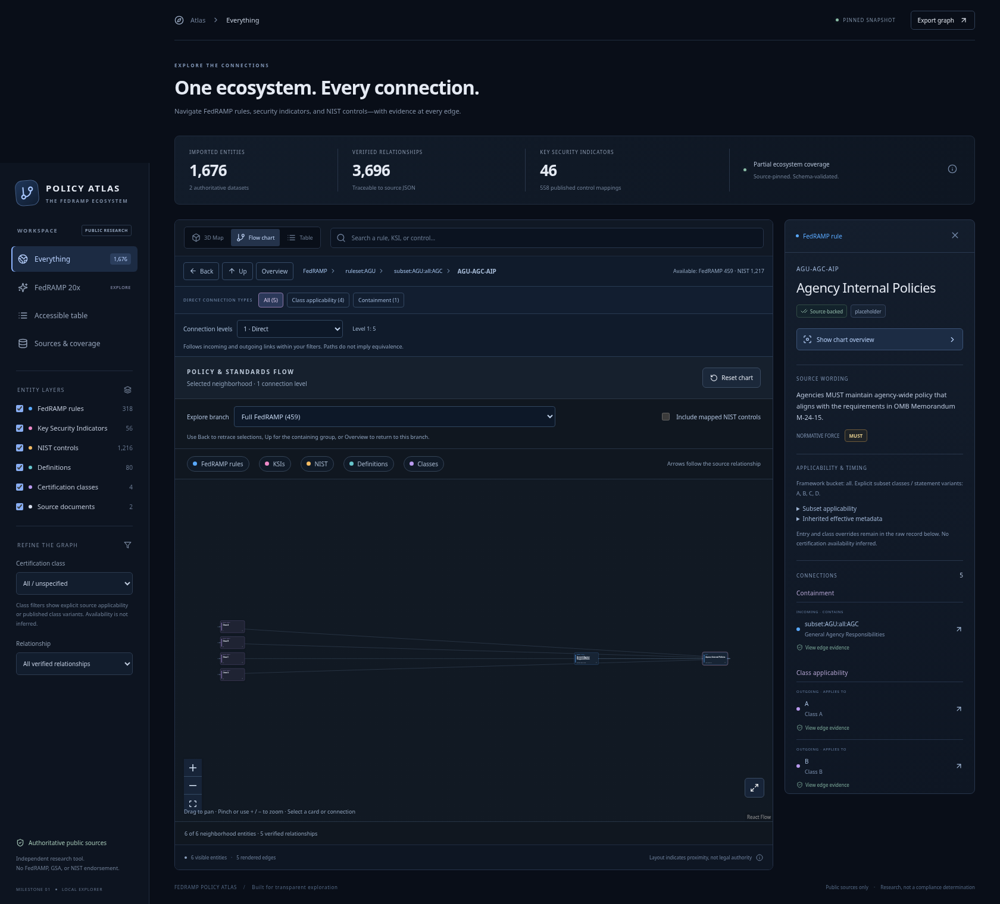
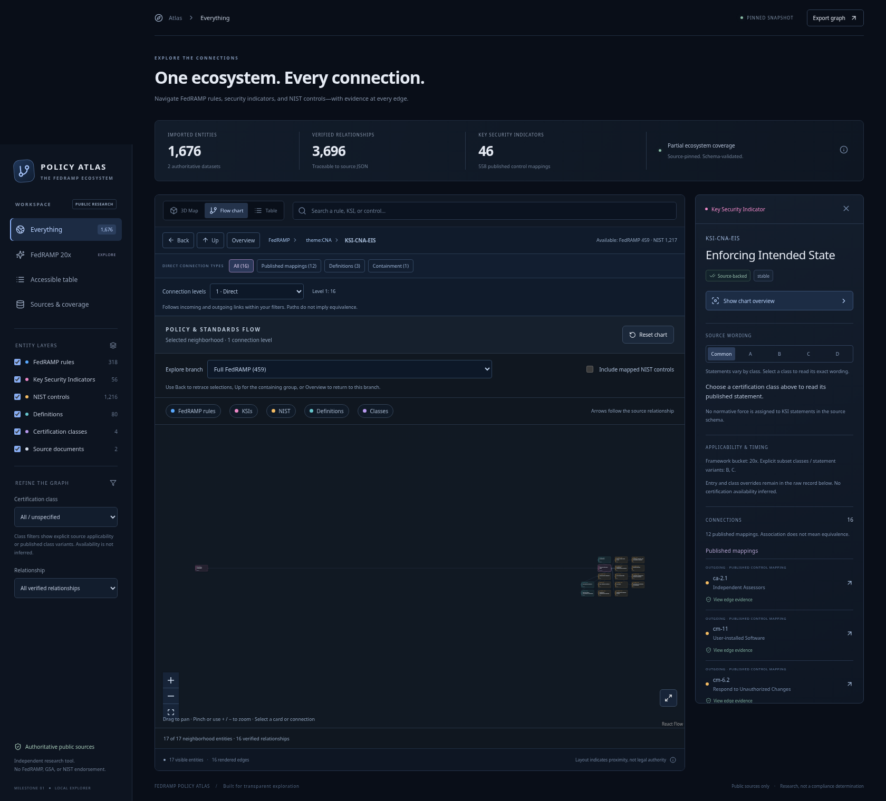

# Flow structure audit — baseline, 2026-10-30

This follow-up audits whether people can read a complete flow after drilling through several entities. The previous audit verified selected-card anchoring, control responses and mobile containment. It missed that preserving global coordinates left huge empty gaps, and it accepted the disabled NIST option without testing the user's task of changing context while selected. Those acceptance criteria were too narrow.

Captured fresh evidence in Chromium 154.0.8037.57, local production preview on port 4187, desktop 1680×1246 and mobile 390×844. Applied the previously read Product Design audit workflow: capture, inspect saved screenshots, then findings. Branded Google Chrome is unavailable; live Pages was not claimed as tested. All eleven screenshots below were opened and inspected. No app code was edited by this agent.

## Findings

- **P1: layout retains positions belonging to excluded entities.** Class D's 60 displayed cards span 6,986 layout pixels. After drilling to AGU-AGC-AIP, just six cards span 4,634 pixels with a 3,010-pixel empty gap. FRD-CCL's fourteen cards span 7,574 pixels. A selected KSI's seventeen cards span 7,868 pixels with a 6,538-pixel empty gap. Fit reduces these small neighborhoods to unreadable strips. Keeping the selected card stationary is not sufficient: the entire current diagram must be readable and compact.
- **P1: NIST context cannot be changed while inspecting a card.** The checkbox is disabled in every selected state. Selecting KSI-CNA-EIS while unchecked nevertheless displays its twelve NIST mappings/targets, so the preference is not respected consistently.
- **P2: long sequences accumulate layout artifacts.** Back correctly restores selected IDs, but the restored diagram is still sparse. Returning to the FedRAMP source after several hops produces a 7,868-pixel-wide 60-card view; preserving viewport state alone cannot repair its underlying layout.
- **P2: search ranking confuses exact class names with prose mentions.** Typing “Class B” and pressing Enter selected FRD-CCC, a definition mentioning Class B, rather than the Class B entity. The state is labelled as a search-result finding; it is not used as evidence about Class B's actual neighborhood.

## Captured task sequence

| Step | Task / health | Evidence |
| --- | --- | --- |
| 1 | Full FedRAMP entry; readable subset, but semantic grouping is weak. | [Full view](ux-01-full-fedramp.png) |
| 2 | Select actual Class D; selected card visible but most related cards far away. | [Selected D](ux-02-class-d-selected.png) |
| 3 | Fit Class D; unreadable long strip. | [Fit D](ux-03-class-d-fit.png) |
| 4 | Search “Class B” + Enter; unexpectedly selects FRD-CCC definition. | [Search mismatch](ux-04-class-b-search-definition.png) |
| 5 | Search AGU-AGC-AIP, Fit; six cards separated by enormous gaps. | [Rule](ux-05-rule-fit.png) |
| 6 | Search FRD-CCL, Fit; fourteen cards separated by enormous gaps. | [Definition](ux-06-definition-fit.png) |
| 7 | Back to rule; correct selection, still unreadably sparse. | [Back](ux-07-back-rule.png) |
| 8 | Search KSI-CNA-EIS with NIST unchecked; NIST cards appear, option disabled. | [Unchecked KSI](ux-08-ksi-nist-off.png) |
| 9 | Return overview, enable NIST, select same KSI; cannot disable while selected. | [Checked KSI](ux-09-ksi-nist-on-disabled.png) |
| 10 | Up to theme, Up to FedRAMP source, Fit; accumulated gaps remain. | [Source](ux-10-fedramp-source-fit.png) |
| 11 | Resize source selection to mobile; selected card visible, full diagram remains sparse. | [Mobile](ux-11-source-mobile.png) |

## Revised acceptance criteria

1. Current-view layout, not historical empty slots: small diagrams must remain compact after arbitrary earlier visits. Measure bounding boxes and maximum empty column gaps; also inspect screenshots and readable text after Fit.
2. Semantic levels: source documents are peers; families/themes/rulesets are distinct from controls/KSIs/rules and enhancements. Do not imply containment or legal authority through invented edges.
3. Selection may move with its compact diagram. Preserve orientation with consistent semantic ranks, labelled groups, Back and breadcrumbs rather than permanently reserving every visited coordinate.
4. NIST controls can be included/excluded while selected. Changes apply to actual displayed nodes and edges, survive depth changes and Back, and have clear behavior if the selected node itself is excluded.
5. Exercise actual linked cards and inspector links, both classes B and D, rule → definition → source, KSI → mapped NIST control, multiple Back/Up steps, Fit and mobile resizing.
6. Verify all rendered edges remain original verified relationships and root/ancestor context is not falsely counted as a published mapping.

Evidence: `ux-baseline.json` includes each route, checked/disabled state, card identities, layout widths/gaps and viewport. `ux-baseline.mjs` reproduces the baseline journey. Layout-space pixels measure the graph coordinates before camera scaling, not browser screen pixels. Final fixes will be assessed in a separate independent retest.
