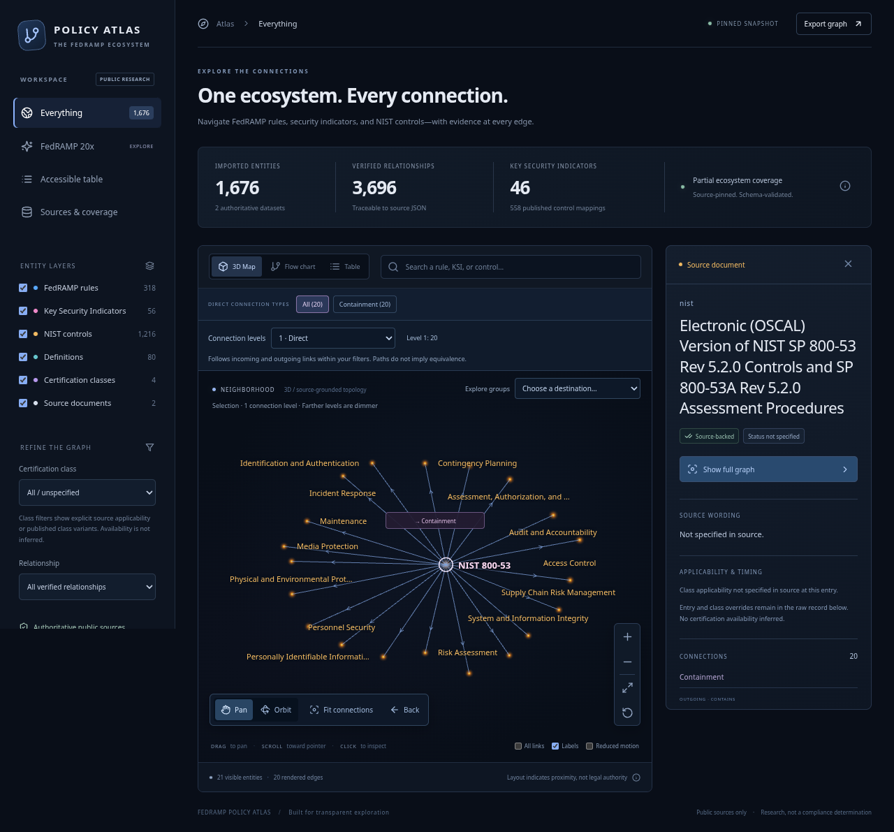
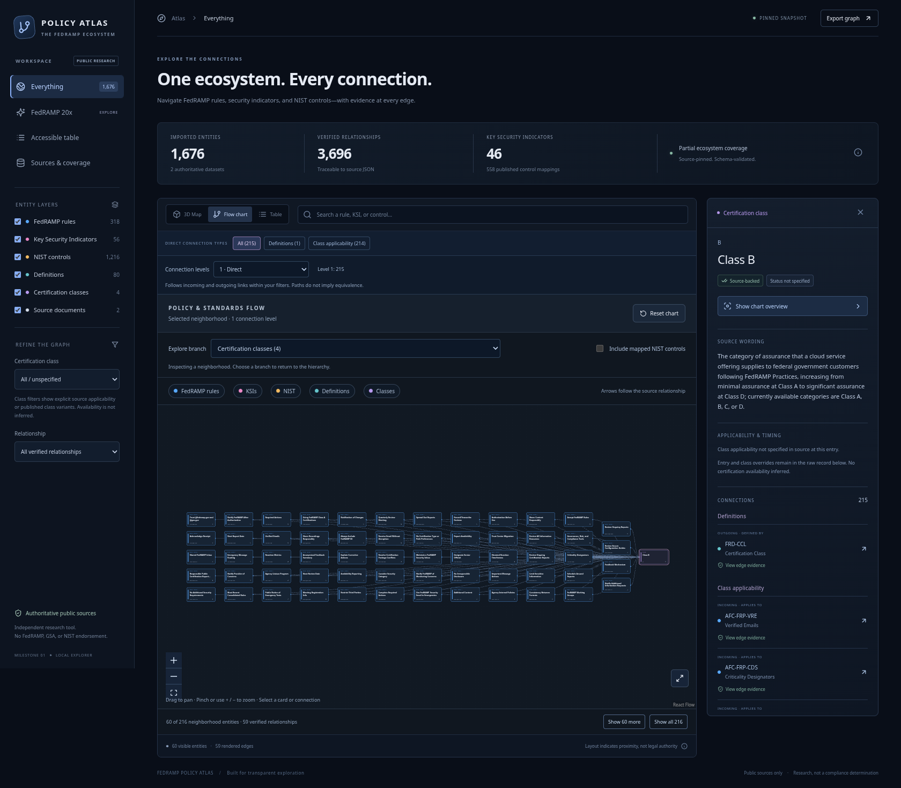
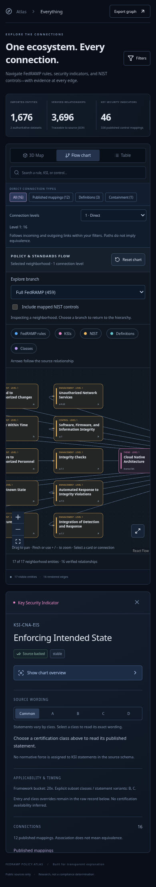

# Independent navigation and UI/UX audit — 2026-10-30

**Latest outcome:** the subsequent [independent retest](retest-report.md) passed all 13 checks on final candidate `index-dK7PwtXj.js`. The findings below are preserved baseline evidence, not current unresolved blockers.

Baseline build: `e1692e7`. Tested in installed Chromium 154.0.8037.57 through Playwright, using the actual local production build at `http://127.0.0.1:4187/FedRAMP-Policy-Atlas/`. Google Chrome is not installed. The public GitHub Pages URL could not be reached because the environment proxy returned CONNECT 403; no bypass was attempted. This is a local-browser audit, not live-site certification.

Applied the Product Design audit workflow: capture first, inspect saved screenshots, then assess navigation and accessibility risks. Saved context was absent; the shared critical-overrides resource was inaccessible. The user's explicitly requested browser testing and existing application target supplied the audit context. No production code was edited by this agent.

## Highest-impact baseline findings

1. **P1 — Everything can still show only NIST.** Open `?node=nist`, activate **Focus neighborhood**, then choose sidebar **Everything**. The route still contains `node=nist`, the inspector remains on NIST, and the graph reports only **21 visible entities / 20 edges**. This is a reproducible explanation for an apparent NIST-only map; it does not prove which actions occurred in the user's session. Clean initial loads showed both FedRAMP and NIST at desktop, laptop and mobile sizes. Fix Everything to restore the complete exploration scope and selection state, or give retained scope a conspicuous indication and recovery action. Evidence: step 16 and `state-checks.json`.
2. **P1 — Back returns the camera, not the exploration.** Choose CNA from Explore groups, search and select KSI-CNA-EIS, then activate **Back**. Camera moves but KSI remains selected and only its relationship labels remain. There is no selection trail or structural parent control. **Focus neighborhood** further removes unrelated entities from the renderer (1,676 → 17). Add semantic Back, parent/group navigation, and a graph-level overview action. Keep contextual points identifiable and clickable unless a user explicitly applies a restrictive filter. Evidence: steps 03–07.
3. **P1 — Selecting Class B destroys spatial orientation and text legibility.** Open the flow Classes branch and select Class B. Its layout position moves from the left to the far right, and the automatic fit renders the first 60 of 216 neighborhood cards as a tiny strip. Selection should preserve a stable location and readable zoom; the source-directed arrow should remain correct even when presentation places a selected class left. Evidence: steps 08–10; DOM positions in `baseline.json`.
4. **P2 — Selected flow card may be offscreen on mobile.** At 390×844, search KSI-CNA-EIS in the map, then switch to Flow chart. Selection is preserved in the inspector, but the auto-fitted chart viewport displays control cards and the theme rather than the selected KSI. Keep the selected card visible when switching modes or relaying out; provide a return-to-selection action if the user pans away. Evidence: step 13.
5. **P2 — Mobile selection recovery requires a long page traversal.** The inspector and its Close/Show chart overview controls are below the graph, more than 1,100 document pixels from the top. The camera-only Back does not substitute for selection recovery. Put Back/Up/Overview near the visualization so users can return without scrolling to the inspector. Evidence: steps 12–13.
6. **P2 follow-up — Mobile filters do not dismiss with Escape.** Filters opens a sidebar overlay; pressing Escape leaves it open, and there is no dialog role or dedicated close control in the overlay. The Filters toggle can dismiss it. Add explicit close, keyboard dismissal and focus restoration; validate focus handling independently. Evidence: step 17 and `state-checks.json`.

## Captured journey

| Step | Action and observed health | Evidence |
| --- | --- | --- |
| 01 | Clean desktop initial map: healthy; both sources visible, 1,676 entities. | [Screenshot](01-desktop-initial.png) |
| 02 | Resize to 1280×900 laptop: healthy initial source visibility. | [Screenshot](02-laptop-initial.png) |
| 03 | Choose CNA theme: selection and relationships work; other context is very dim and unlabelled. | [Screenshot](03-group-selected.png) |
| 04 | Search and select a KSI: shared inspector and evidence paths work; source/group landmarks disappear. | [Screenshot](04-ksi-selected.png) |
| 05 | Activate map Back: impaired; camera returns, selected KSI does not. | [Screenshot](05-camera-back-selection-persists.png) |
| 06 | Focus neighborhood: works as implemented but removes the contextual graph. | [Screenshot](06-focus-hidden-context.png) |
| 07 | Close inspector: returns full graph, demonstrating the dependency on Close for recovery. | [Screenshot](07-close-to-return.png) |
| 08 | Open flow Classes: clear and readable four-card branch. | [Screenshot](08-flow-classes.png) |
| 09 | Select Class B: impaired; card jumps right and automatic fit makes text unreadable. | [Screenshot](09-class-selected-moves.png) |
| 10 | Show chart overview: restores classes; prior selection history is not available. | [Screenshot](10-chart-overview-return.png) |
| 11 | Clean mobile initial map: healthy source visibility and page reflow; small supporting text remains an accessibility consideration. | [Screenshot](11-mobile-initial.png) |
| 12 | Mobile KSI selection: works, but recovery controls sit below the chart. | [Screenshot](12-mobile-selected.png) |
| 13 | Mobile switch to Flow: selection survives, selected card is outside initial viewport. | [Screenshot](13-mobile-flow-selected.png) |
| 14 | Mobile CNA branch: cards readable with panning; complete branch is reachable. | [Screenshot](14-mobile-branch.png) |
| 15 | Tablet CNA branch: responsive controls and readable cards; side navigation consumes substantial width. | [Screenshot](15-tablet-branch.png) |
| 16 | NIST focus → Everything: impaired; 21-node NIST scope remains. | [Screenshot](16-everything-retains-nist-focus.png) |
| 17 | Mobile Filters → Escape: impaired keyboard dismissal; overlay remains open. | [Screenshot](17-mobile-filters-escape.png) |

### Evidence for the principal problems

## Strengths and verification limits

The three presentation tabs, typed relationship controls, source inspector, visible coverage counts and source-pinned wording provide a strong basis for evidence exploration. Clean initial states retain the complete graph. Keyboard Enter activates search results, and map keyboard zoom/Escape camera navigation work. No uncaught browser errors were observed during the 15-state capture.

This is a navigation-centered audit, paired with a separate agent's functional coverage. It is not exhaustive accessibility certification, a screen-reader audit, a physical touch-device test, a Safari/Firefox test or a live deployment test. Small font sizes, low-contrast contextual points and compact controls warrant measured contrast/target-size and assistive-technology validation. Screenshots alone cannot establish compliance. Full-page screenshots include sticky-navigation positions after scrolling; those capture artifacts were not treated as standalone layout defects.

Baseline metadata: `baseline.json`, `state-checks.json`. Reproducible browser journeys: `capture.mjs`, `state-checks.mjs`. Parent implementation fixes and independent retest results will be recorded separately rather than rewriting the baseline evidence.
