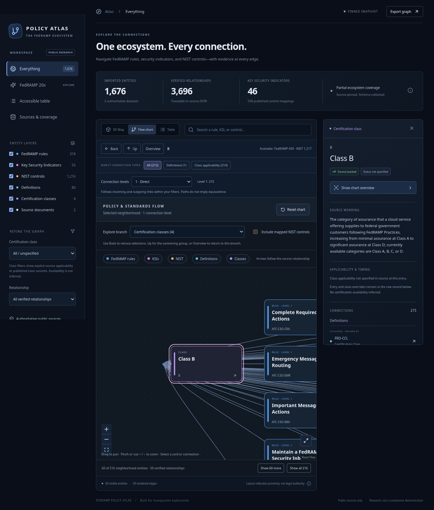
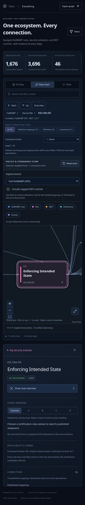
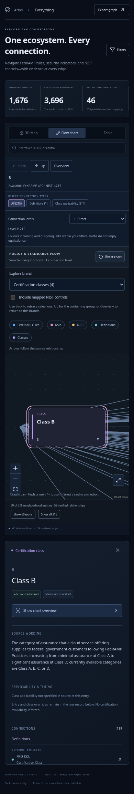

# Independent UX retest — 2026-10-30

**Result: all 13 checks passed on the final local production candidate**, main asset `index-dK7PwtXj.js`. All nine saved retest screenshots were opened and inspected. No uncaught browser errors. Tested with Chromium 154.0.8037.57 on 1280×900 desktop, 768×1024 tablet and 390×844 mobile viewports. This remains a local production-build test; branded Google Chrome is absent and the public Pages domain is blocked by the environment's proxy.

| Step | Retested journey | Health / evidence |
| --- | --- | --- |
| 1 | NIST focus → Everything | Pass. Restores all 1,676 entities, clears selection and shows both source labels. [Screenshot](retest-01-everything-restored.png) |
| 2 | CNA → KSI → semantic Back → browser Forward | Pass. Back restores CNA; Forward restores the KSI. [Screenshot](retest-02-back-to-group.png) |
| 3 | KSI → Up → theme → Up → FedRAMP → Overview | Pass. Traverses actual structural parents and returns to unselected overview. |
| 4 | Focused KSI → Fit all → click dimmed FedRAMP context label | Pass. All 1,676 eligible points remain; the dimmed label is clickable and selects FedRAMP. [Screenshot](retest-03-dim-context.png) |
| 5 | Classes → select Class B | Pass. Coordinates remain `translate(28px, 174px)`; selected card stays inside the chart at readable zoom 0.938182. [Screenshot](retest-04-class-stable.png) |
| 6 | Selected Class B → 3D → Flow → reload | Pass. Class coordinates persist and the card remains within the chart viewport. |
| 7 | Zoom classes → select Class B → Back | Pass. Returns to the four-card branch and restores the exact saved viewport transform. [Screenshot](retest-05-flow-back.png) |
| 8 | Desktop selected Class B → resize to mobile | Pass. Entire selected card remains inside the chart after responsive resize. [Screenshot](retest-09-mobile-resize-selection.png) |
| 9 | Mobile map KSI selection → Flow chart | Pass. The entire selected KSI card is centered inside the chart rather than offscreen. [Screenshot](retest-06-mobile-selected-card.png) |
| 10 | Mobile Up → Overview | Pass. Recovers using the controls above the graph without needing inspector Close. [Screenshot](retest-07-mobile-overview.png) |
| 11 | Mobile Filters → Escape | Pass. Sidebar closes, `aria-expanded` becomes false, and focus returns to Filters. |
| 12 | Tablet CNA flow branch | Pass. Controls fit without page-level horizontal overflow. [Screenshot](retest-08-tablet-flow.png) |
| 13 | Browser runtime errors | Pass. No uncaught JavaScript errors in the complete retest. |

The visible **Camera back** label now distinguishes camera history from the exploration **Back** control. Source counts are labelled **Available**, reducing confusion between the eligible dataset and the current chart slice.

## Remaining non-blocking considerations

- A large selected neighborhood still contains many lines; stable position and readable selected-card zoom make it usable, but users must pan to see distant cards. Edge routing and labeling research remain worthwhile.
- Mobile pages remain tall. “Visible selected card” here means contained within the chart's viewport; the page may still need scrolling to reach the chart itself. Back/Up/Overview are above the chart and no longer depend on reaching the inspector below it.
- Sidebar keyboard dismissal is repaired. A comprehensive screen-reader, contrast, focus-order, target-size and physical touch-device audit remains outside this run. No WCAG compliance claim is made.
- Source data and legal applicability were not independently re-audited; this agent tested navigation and visual behavior against existing source-backed records.

Evidence: `retest.json`, `retest.mjs`, and the nine `retest-*.png` images. The baseline report and screenshots are preserved in `report.md`; its P1/P2 findings describe the earlier build rather than current unresolved blockers. One initial harness assertion incorrectly compared a selected card's changing z-index; it was corrected to compare layout coordinates. A second attempt hit a temporary preview rebuild and was discarded. The final recorded run is clean.
